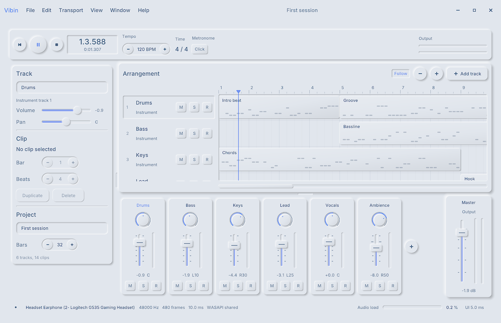
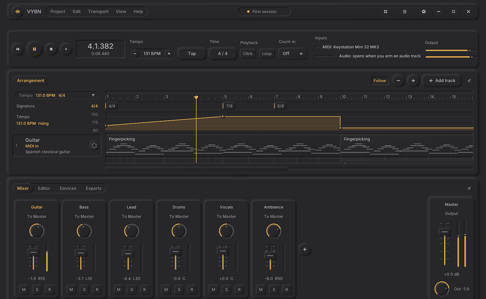
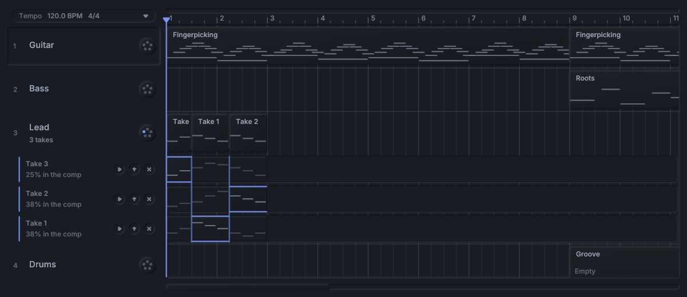
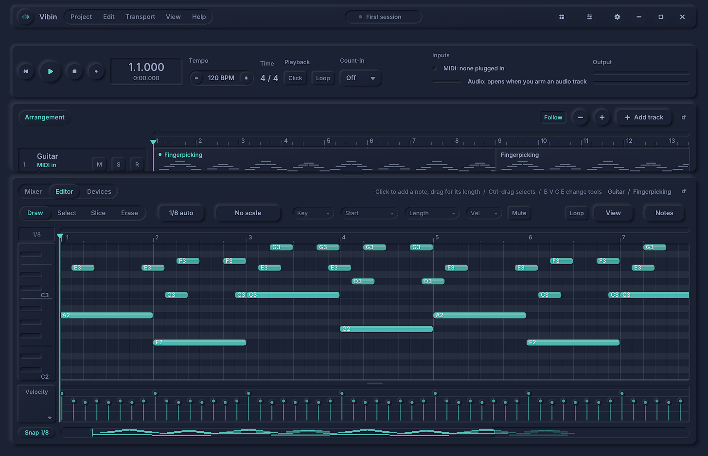
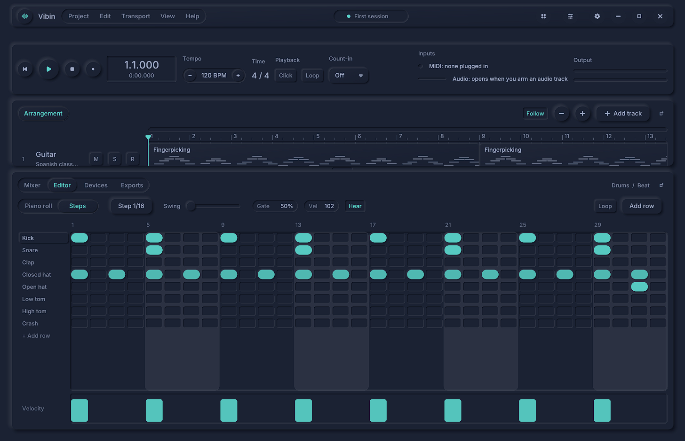
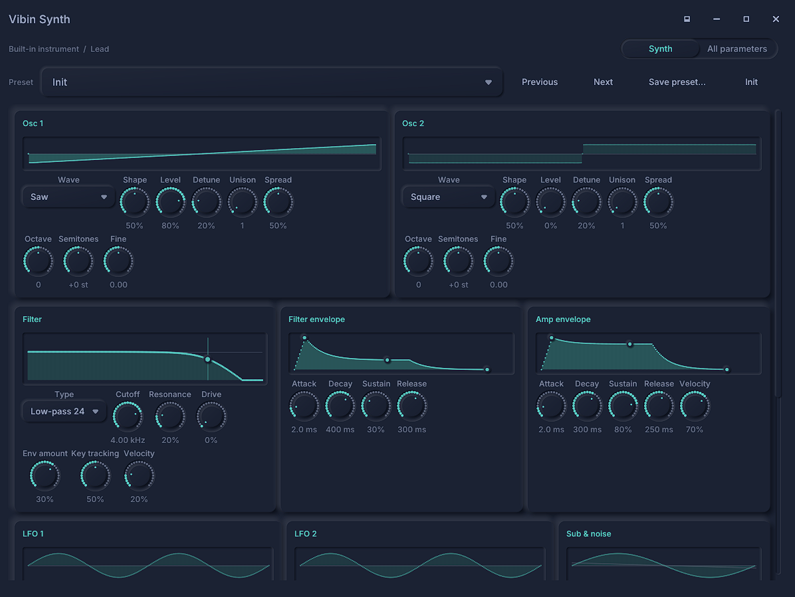
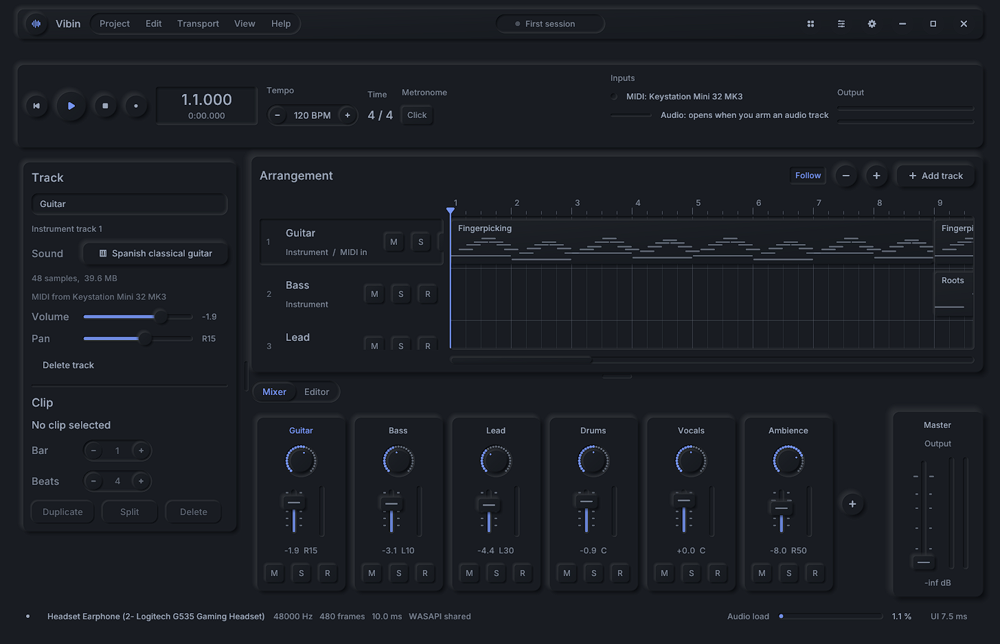
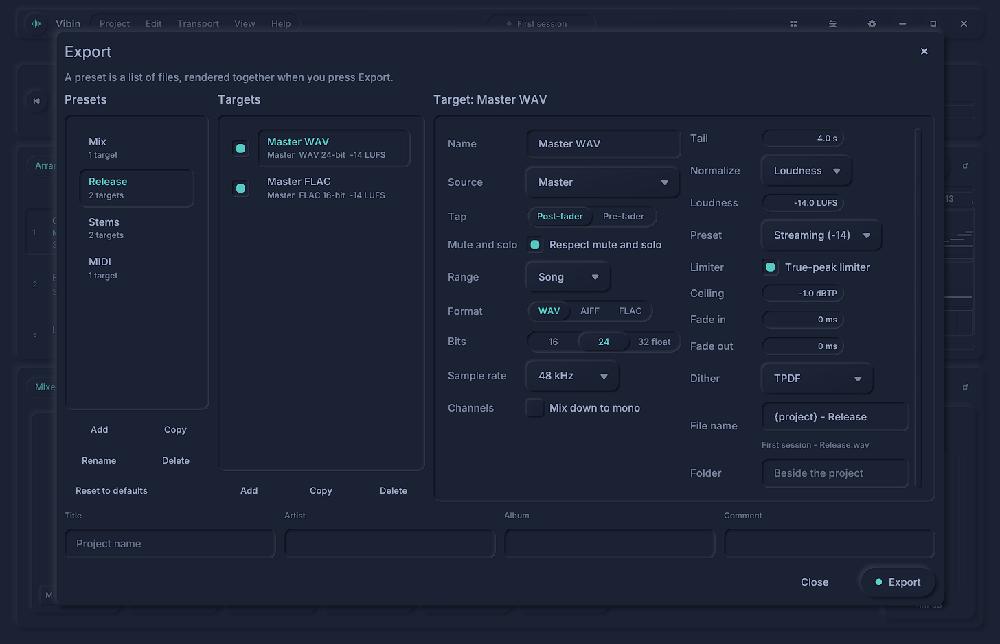

<div align="center">

# VYBN

**A digital audio workstation for Windows, written from scratch in C++17.**

Instrument and audio tracks, a tempo map, take comping, a piano roll, a step sequencer, a built-in
synth, and CLAP plugins in sandboxed processes, drawn in a neumorphic interface with Vulkan.




</div>

---

## Highlights

- **Tracks.** Instrument tracks (the built-in synth, the sample library, or CLAP plugins), audio
  tracks, return tracks fed by sends, and group tracks that fold.
- **Arrangement.** Automation lanes, a tempo map with tempo changes, ramps and time-signature changes,
  and undo for every edit.
- **Recording.** Audio and MIDI. Loop recording puts a take on each lap into take lanes, and you comp
  the best parts of each take by swiping across them.
- **Editing.** A piano roll with note tools and an arpeggiator, a step sequencer with swing, and an
  audio clip editor.
- **Mixing.** A mixer with sends, groups and a master volume. Built-in EQ, filter, gate, compressor
  (with sidechains), limiter, saturation, delay and reverb. CLAP effects run in a sandbox. Delay
  compensation covers the whole routing.
- **Export.** WAV, AIFF, FLAC, MP3 and MIDI, normalised to a peak or to EBU R128 loudness, rendered in
  the background.

## Screenshots

<table>
  <tr>
    <td width="50%"><br><sub><b>Tempo map.</b> Ramps, tempo changes and time-signature changes, drawn in the arrangement.</sub></td>
    <td width="50%"><br><sub><b>Takes and comping.</b> Each lap becomes a take; the comp picks the best part of each.</sub></td>
  </tr>
  <tr>
    <td width="50%"><br><sub><b>Piano roll.</b> Note tools, a velocity lane and snapping.</sub></td>
    <td width="50%"><br><sub><b>Step sequencer.</b> Drum patterns on a 1/16 grid, with gate, velocity and swing.</sub></td>
  </tr>
  <tr>
    <td width="50%"><br><sub><b>Built-in synth.</b> Two oscillators, a filter, envelopes, LFOs and presets.</sub></td>
    <td width="50%"><br><sub><b>Dark and light themes.</b> Both are first-class; the look is customisable.</sub></td>
  </tr>
  <tr>
    <td colspan="2"><br><sub><b>Export.</b> Presets of targets, EBU R128 loudness normalisation, a true-peak limiter and dither.</sub></td>
  </tr>
</table>

## Built with

| | |
|---|---|
| **Language** | C++17, Windows only |
| **Interface** | Vulkan, drawn by the app's own UI layer (GLFW windows) |
| **Audio** | miniaudio on WASAPI |
| **Plugins** | CLAP, each hosted in a sandboxed process |
| **Project files** | `.vbp`, TOML |
| **Build** | CMake 3.16+, MinGW Makefiles (64-bit TDM-GCC) |

## Getting started

### Requirements

- Windows, with the Vulkan SDK (`VULKAN_SDK` set).
- CMake 3.16 or newer, the 64-bit TDM-GCC toolchain, and git. The first configure fetches GLFW, stb,
  miniaudio and the CLAP headers.
- MP3 export uses Windows' Media Foundation. On Windows N editions, install the Media Feature Pack.

### Build

```bash
cmake -S . -B build -G "MinGW Makefiles" -DCMAKE_C_COMPILER=C:/TDM-GCC-64/bin/x86_64-w64-mingw32-gcc.exe -DCMAKE_CXX_COMPILER=C:/TDM-GCC-64/bin/x86_64-w64-mingw32-g++.exe
cmake --build build -j 8
```

### Run

```bash
output/vybn.exe
```

Pass a `.vbp` path to open a project, or `--demo NAME` to start on one of the screenshot scenes. The
full list of flags and demos is in [`docs/reference/commands.md`](docs/reference/commands.md).

## Testing

```bash
bash tools/test.sh
```

Runs every self-test suite in parallel and prints a table: audio, project, input, notes, engine,
browser, plugin, synth, export, and the render suite, which compares the views with golden images.
See [`docs/testing.md`](docs/testing.md).

## Project layout

| Path | What's in it |
|---|---|
| `src/env/` | Daemons, the scheduler and its thread pools |
| `src/engine/` | Windows, input, Vulkan rendering, file dialogs, HTTP |
| `src/ui/` | The UI layer: layout, components, draw caches |
| `src/plugin/` | CLAP hosting and the sandboxed host program |
| `src/audio/` | The audio engine: instruments, effects, automation, routing, encoders |
| `src/daw/` | The DAW: the model, files, library, audio bridge, views and app |
| `tests/` | Self-test suites, test plugins and golden images |
| `docs/` | Architecture of each module, the command and build reference, design notes |

[`CLAUDE.md`](CLAUDE.md) is the short guide for working in the code, and
[`docs/architecture/`](docs/architecture/) has the detail for each module.
